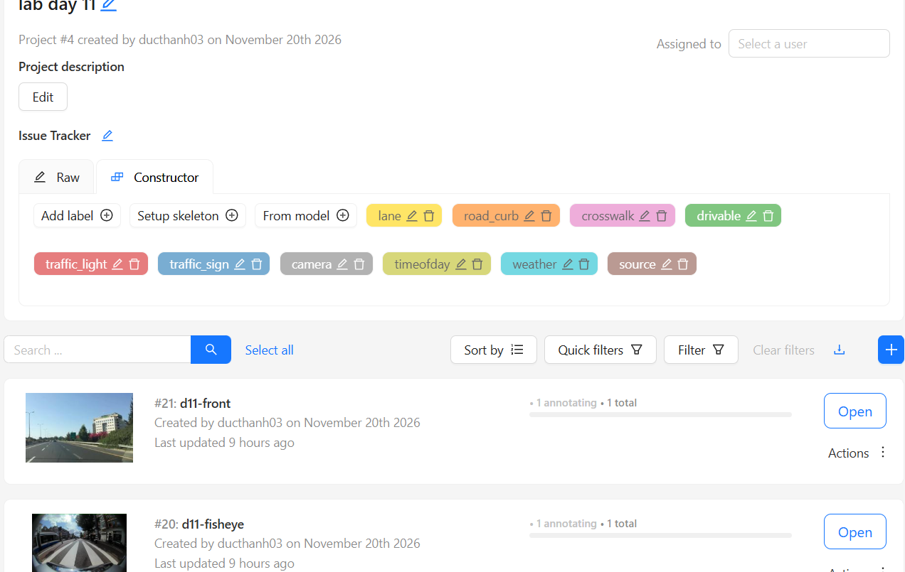
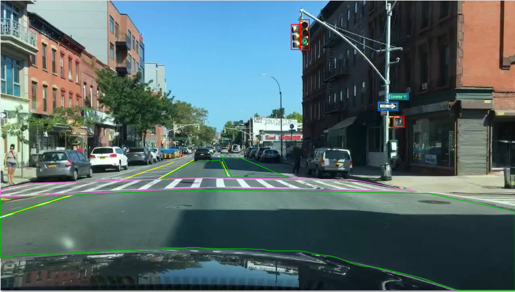
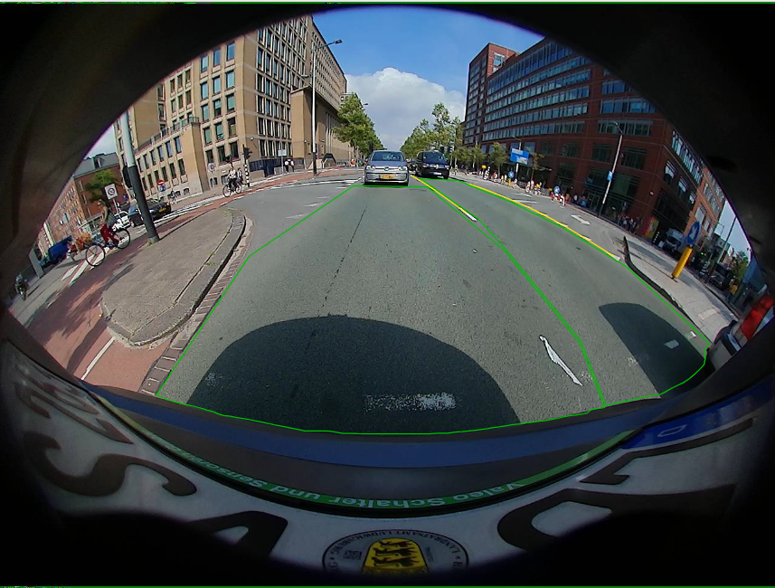

# Báo cáo cá nhân — Ngày 11
Họ tên: Lê Đức Thanh      Mã học viên: 2A202603328  
Phiên bản CVAT (Help → About): Server version 2.74.1, UI version 2.74.1  
Guideline: Road v1.0    Lần nộp (`revision` trong manifest): 2  
Thời điểm export (ngày giờ trên CVAT): front và fisheye 21/11/2026 00:18 (giờ Việt Nam; trong XML ghi UTC 20/11 17:18). Bản revision 1 export lúc 20/11/2026 23:36 (front) và 23:27 (fisheye), lưu ở `r1/`    Số lần nộp lại sau Rework: 1

## 1. Kiểm project
| Mục | Đúng như guideline Road v1.0? | Ghi chú |
| --- | --- | --- |
| 6 label, đúng kiểu | Đúng | `lane`, `road_curb`: polyline · `crosswalk`, `drivable`: polygon · `traffic_light`, `traffic_sign`: rectangle. Label dán vào tab Raw từ `configs/road_v1_labels.json`; file này khớp với `python -m road_lab.taxonomy` |
| Thuộc tính và giá trị | Đúng | Phần `<meta>` của file export liệt kê đủ: `position` L1/R1/L2/R2/other, `style`, `color`, `kind`, `area_type`, đèn `color`/`type`/`facing`, biển `group`/`facing`, `edge_zone` là checkbox |
| 4 tag ảnh | Đúng | `camera`, `timeofday`, `weather`, `source`: mỗi label kiểu Tag có một thuộc tính select tên `value` |

Cách kết thúc polyline trên bản CVAT này: chọn Polyline, label `lane`, bấm **Shape**; click từng điểm trên tâm vệt sơn từ gần xe ra xa; bấm phím **N** để kết thúc. Sau đó mở **Details** sửa thuộc tính, vì polyline mới luôn mang mặc định `L1 / solid / white / single`.  
Cách đặt tag ảnh trên bản CVAT này: dùng công cụ **Tag** ở thanh bên trái, chọn label (camera trước tiên) rồi chọn giá trị `value`. CVAT tự điền giá trị đầu danh sách (ví dụ `weather = clear`), nên phải mở Details của từng tag để kiểm lại. Mỗi ảnh đặt đủ 4 tag.

## 2. Số lượng đã gán
| Task | Ảnh | lane | road_curb | crosswalk | drivable | traffic_light | traffic_sign |
| --- | ---: | ---: | ---: | ---: | ---: | ---: | ---: |
| front | 12 | 34 | 8 | 2 | 25 | 10 | 9 |
| front-extra (đã làm 4 / 4) | 4 | 10 | 3 | 6 | 9 | 4 | 12 |
| fisheye | 8 | 8 | 8 | 7 | 9 | 7 | 1 |
| fisheye-extra (đã làm 4 / 4) | 4 | 2 | 1 | 3 | 0 | 0 | 1 |

Ảnh thêm nằm chung task với ảnh bắt buộc: task `front` có A01–A16, task `fisheye` có B01–B12. Mỗi task có một job, nên mỗi file zip nộp chỉ cần một `annotations.xml`. Số liệu đếm từ hai file đã nộp.

## 3. Bảng ca khó
| Ảnh | Nhãn | Phân vân giữa | Đã chọn | Lý do |
| --- | --- | --- | --- | --- |
| A04, A11, A14 | `lane` vạch vàng đôi | 2 polyline (mỗi vệt sơn một nét) / 1 polyline | 1 polyline nằm giữa hai vệt, `L1 · solid · yellow · double` | Guideline: một vạch kẻ làn là một polyline; vạch đôi (QCVN 1.3) ghi bằng `kind = double`. Đây là vạch sát bên trái làn mình nên là L1, dù màu vàng |
| A05 | `lane` L1, R1 | Vẽ theo mép hàng xe đỗ / không vẽ | Không vẽ lane | Đường khu dân cư không có vạch sơn. Guideline mục 6: không vẽ vạch mà ảnh không có. Lint còn báo QC1-02 |
| A09 | `lane` R1 | Vẽ R1 / không vẽ | Không vẽ R1 | Bên phải làn chỉ có lề và xe đỗ, không có vạch sơn. |
| A14 | `lane` R1 | Vẽ R1 / không vẽ | Không vẽ R1 | Ảnh đêm, bên phải làn không thấy vạch. |
| A06 | `lane` L1 | `other` / L1 | L1 (vạch vàng đôi ở xa) | Dưới gầm đường ray, gần xe không có vạch; vạch vàng đôi phía trước là vạch giữa đường của chính làn này. Điểm đầu không sát xe được vì đoạn gần không có sơn |
| A12 | `lane` bên trái | 3 polyline cùng `L1` (bản r1) | Vạch trắng liền ngay sau vạch qua đường là **L1**. Vạch đứt kế bên ngoài là **L2**. Vạch đứt gần xe, trước vạch qua đường, cũng là **L2**: giữ 2 polyline | Hai vạch phía sau vạch qua đường cùng nằm ở hàng y ≈ 442; vạch gần xe hơn mới là L1. Vạch gần xe thẳng hàng với L2 phía sau, nên là cùng một vạch bị vạch qua đường cắt. Lint còn báo "2 polyline cùng L2"; tôi giữ 2 đoạn vì vạch thật sự đứt qua giao lộ, không phải bị che |
| A04 | `lane` R2 | Vạch đơn / đôi; đặt trên một vệt / giữa hai vệt | `R2 · solid · white · double`, polyline nằm giữa hai vệt | Đo độ sáng theo cột thấy hai vệt trắng song song, cách nhau 10–16 px. Làm giống vạch vàng đôi: một polyline ở giữa |
| A06, A12 | `traffic_sign` group | information / supplementary / mandatory | Biển ONE WAY: `mandatory`; biển tên đường màu xanh: `information` | Bảng nhóm biển của guideline: "One Way" thuộc biển hiệu lệnh. Biển tên đường có chức năng chỉ dẫn, không phải tấm phụ dưới biển chính |
| B02 | `traffic_light` mới thêm ở mép trái | `vehicle` / `pedestrian` | `vehicle` | Đèn đỏ cao ≈ 30 px ở mép ảnh, không thấy rõ hình người hay xe đạp trên mặt đèn. `edge_zone` bật vì tâm nằm ngoài 80 % bán kính |
| A03 | tag `timeofday` | `day` / `dusk` | `dusk` | Nắng thấp, bầu trời ngả màu chiều, nhiều xe đã bật đèn |
| A06 | tag `weather` | `other` / `overcast` | `overcast` (bản r1 là `other`) | Gầm đường ray che phần lớn bầu trời, nhưng phần trời thấy được bên phải trắng xám, mặt đường khô |
| A14, A16 | tag `weather` | `clear` / `overcast` / `other` | `other` | A14: ảnh đêm, không xác định được trời; A16: nhà cao tầng che gần hết bầu trời, chỉ còn một khe trời nhỏ ở giữa ảnh, không đủ để chọn giữa `clear` và `overcast` (mặt đường khô, không mưa) |
| B05–B08 | `lane` position | L1/R1/R2 / `other` | `other` | Guideline mục 4: ở fisheye_left và fisheye_right luôn dùng `position = other` |
| B07 | `lane` | Gán lane / không gán | Không gán lane | Hàng tam giác nhường đường là vạch ngang, không phải vạch kẻ làn |
| B11 | `lane` | Viền ô đỗ / vạch dọc | Bỏ viền ô đỗ; giữ 2 vạch vàng (R1 trong, R2 ngoài) | Guideline mục 4: vạch ô đỗ không gán lane (slot B11 ghi rõ đây là bẫy QC1-03) |
| B01–B12 | tag `weather` | `clear` / `overcast` | `clear` | Camera hai bên gần như không thấy trời; mặt đường khô, nắng rõ nên chọn `clear` |

## 4. Phiếu QC 1 nhận được
Bạn kiểm lô của tôi: Phạm Trần Anh (phiếu `phamtrananh-qc1-for-leducthanh.md`; dự thảo do tôi tự kiểm rồi gửi bạn xác nhận, theo cách cặp chúng tôi làm)  Quyết định nhận được: **Rework** (1 lỗi nặng; lỗi chính 7 / 73 nhãn = 9,6 %)  
| Mã lỗi | Số lỗi | Đồng ý? | Đã sửa? |
| --- | ---: | --- | --- |
| QC1-03 position | 1 | Đồng ý | Đã sửa: A12 có L1 là vạch sát xe sau vạch qua đường, vạch kế bên ngoài và đoạn gần xe là L2 |
| QC1-04 tâm vạch, bỏ sót | 1 | Đồng ý | Đã sửa: A04 thêm R2 (vạch trắng đôi, polyline giữa hai vệt) |
| QC1-07 vùng lái | 2 | Đồng ý | Sửa 1/2: B06 đã thêm drivable. B02 chưa sửa ở revision 2: drivable direct vẫn chưa kéo tới mép thân xe |
| QC1-08 đèn | 1 | Đồng ý | Đã sửa: B02 thêm đèn đỏ ở mép trái, `edge_zone` bật |
| QC1-09 group biển | 3 | Đồng ý | Đã sửa: 2 biển ONE WAY (A06, A12) thành `mandatory`, biển tên đường A12 thành `information` |
| QC1-01 tag weather (nhẹ) | 1 | Đồng ý | Đã sửa: A06 `weather` từ `other` thành `overcast` |

Đã sửa những gì (revision 1 → 2):
- A04: thêm 1 lane R2.
- A06: sửa group 2 biển và tag weather.
- A12: sửa position 3 lane và group 2 biển.
- B02: thêm 1 đèn.
- B06: thêm 1 drivable.

Bản revision 1 (2 file zip và `leducthanh-manifest-r1.json`) lưu ở thư mục `r1/`. Manifest mới ghi `revision: 2`.

## 5. Kiểm file export
Mở lại cả hai file bằng `road_check lint leducthanh-front.zip leducthanh-fisheye.zip`: đọc được 28 ảnh, không file nào kèm ảnh (`contains_images: false` trong manifest), 28/28 ảnh đủ 4 tag.

| File | Mở lại được? | Số shape ảnh 1 (job / file) | Số shape ảnh 2 (job / file) | Tag camera có trong XML? |
| --- | --- | --- | --- | --- |
| `leducthanh-front.zip` | Có | A01: 8 / 8 | A02: 8 / 8 | Có (`<tag label="camera">` = `front`, 16/16 ảnh) |
| `leducthanh-fisheye.zip` | Có | B01: 6 / 6 | B02: 8 / 8 | Có (`fisheye_front/rear/left/right` đúng hậu tố FV/RV/MVL/MVR, 12/12 ảnh) |

Cách đếm hai cột: số "file" đếm lại khi mở file zip; số "job" đếm theo nhãn trong job sau khi upload. Bản tôi upload lên job và bản export lại từ job khớp từng nhãn (so cả tag, hình và thuộc tính), nên hai số bằng nhau.

Lint lần cuối (revision 2): 5 cảnh báo, gồm 4 nặng và 1 chính.
- 4 nặng là QC1-02 ở các ảnh không có vạch: A05 (L1, R1), A09 (R1), A14 (R1).
- 1 chính là "2 polyline cùng L2" ở A12. Đây là chủ ý, xem mục 3.

Lint lần đầu có 71 cảnh báo ở front và 67 ở fisheye, xem mục 7.

## 6. Ảnh chụp màn hình
Ảnh chụp nằm trong thư mục `img/` đi kèm báo cáo.

1. Tab Labels của project: project "lab day 11" (CVAT lớp) có đủ 6 label vẽ và 4 label tag, cùng 2 task `d11-front` (#21) và `d11-fisheye` (#20).

   

2. Một ảnh camera trước đã gán đủ (làn, vùng lái, đèn/biển): A12, gồm L1/L2/R1, crosswalk, drivable direct/alternative, 3 đèn và 2 biển (ONE WAY, tên đường).

   

3. Một ảnh fisheye đã gán: B03 (`fisheye_rear`), R1 và R2 đi theo cung, drivable direct/alternative dừng ở mép thân xe.

   
4. Một đoạn XML có `<polyline label="lane">`:

```xml
<polyline label="lane" source="file" occluded="0" points="141.41,693.83;273.52,579.66;311.20,548.42;335.01,527.96;344.71,519.88;353.11,513.44;359.31,509.36" z_order="0">
  <attribute name="position">L1</attribute>
  <attribute name="style">dashed</attribute>
  <attribute name="color">white</attribute>
  <attribute name="kind">single</attribute>
</polyline>
```
(A01, `leducthanh-front.zip`: L1 trắng đứt, điểm đầu y = 694 sát xe, đi lên tới y = 509.)

## 7. Tự đánh giá
**Lỗi tôi mắc nhiều nhất hôm nay** là **QC1-01: thiếu tag**.

Ở lần export đầu:
- 16 ảnh front chỉ có tag `weather`;
- 12 ảnh fisheye không có tag nào.

Tổng cộng 28 lỗi nặng thiếu `camera`, cộng thêm các lỗi nhẹ thiếu `timeofday` và `source`. Lỗi nhiều thứ hai là đặt `position` sai:
- vạch vàng đôi sát xe để `other`, hoặc vẽ thành 2 polyline (A03, A04, A11, A14);
- 3 polyline cùng mang `position = L1` (A09, A12);
- dùng L1/R1/R2 ở camera hai bên (B06–B08, lỗi nặng QC1-03).

Cách tránh ở Ngày 20:
- Đặt đủ 4 tag (camera trước tiên) **ngay khi mở ảnh**, trước khi vẽ.
- Xong ảnh đầu tiên thì export thử và chạy `road_check lint` một lần, để lỗi không lặp ra cả lô.
- Sau mỗi polyline, mở Details đổi ngay `position`, `style`, `color`, `kind`, vì giá trị mặc định `L1 / solid / white / single` luôn hợp lệ nên lint không bắt được.

**Nhãn của tôi đi vào model ở đâu?** Polyline `lane` được lấy mẫu thành đích row-anchor: mỗi hàng ảnh có một giá trị x cho L1 và R1. Model học từ các đích này để dự đoán biên làn đang đi, và hệ thống LKA dùng biên làn đó để giữ xe trong làn.

**Một lỗi đã sửa và cách nó làm model học sai:** ở A04, vạch vàng đôi sát bên trái được gán `other` và vẽ thành 2 polyline. Khi đó:
- Đích L1 của mọi hàng trong ảnh này là "không có làn", dù thực tế có vạch giữa đường. Model sẽ học rằng gặp vạch vàng đôi thì không có biên trái.
- Hai polyline song song lại dạy model rằng đó là hai vạch riêng.
- Hậu quả: LKA không có biên trái để giữ xe và có thể để xe lấn sang làn ngược chiều. Đây đúng là lỗi nặng mà phiếu QC 1 xếp loại.

Tương tự, thiếu tag `camera` thì không tách được ảnh fisheye khỏi ảnh camera trước khi huấn luyện. Thiếu `timeofday` hay `weather` thì không đếm được độ phủ ODD (bao nhiêu ca đêm, ca mưa).

## 8. (Tùy chọn, buffer) Từ polyline đến đích row-anchor
Ảnh A01, vạch R1 (tính bằng `python -m road_lab.rowanchor leducthanh-front.zip --image A01 --position R1`):

| y | 720 | 680 | 640 | 600 | 560 |
| --- | ---: | ---: | ---: | ---: | ---: |
| x của leducthanh | không có làn | không có làn | 603.8 | 544.7 | 484.6 |
| x của phamtrananh | không có làn | không có làn | 599.4 | 542.6 | 484.5 |

Trả lời 3 câu:

1. **Dừng polyline sớm 40 px thì hàng nào thành "không có làn"?** R1 của tôi đi từ y = 650 lên tới y ≈ 524. Nếu dừng sớm 40 px, đầu xa chỉ còn tới y ≈ 564, nên **hàng 560** đổi thành "không có làn". Hàng 720 và 680 vốn đã là "không có làn", vì vệt sơn R1 gần nhất bắt đầu ở y = 650. Mất hàng gần xe như vậy là loại thiếu nguy hiểm nhất.
2. **So với bạn được kiểm, lệch bao nhiêu ở hàng 720 và 560?**
   - Hàng 720 (và 680): cả hai đều "không có làn", vì R1 của cả hai bắt đầu từ vệt sơn gần nhất ở khoảng y = 650. Không lệch, nhưng cả hai cùng thiếu đích ở hàng gần xe.
   - Hàng 560: 484.6 so với 484.5, lệch **0.1 px**.
   - Lệch lớn nhất ở hàng 640: 603.8 so với 599.4, lệch **4.4 px**, vẫn dưới ngưỡng 5 px. Hàng 600 lệch 2.1 px.

   Lệch ở **hàng gần xe (720, rồi 640)** ảnh hưởng LKA nhiều hơn. Hàng này quyết định vị trí ngang của xe so với biên làn ngay lúc này, nên vài pixel ở đây đổi thành sai số lớn hơn trên mặt đường. Hàng 560 ở xa chủ yếu ảnh hưởng hướng làn phía trước. Vì vậy chỗ lệch 4.4 px ở hàng 640 đáng chú ý hơn chỗ gần như trùng ở hàng 560.
3. **Vẽ từ xa về gần thì cách tính có đổi không? Script nào gặp khó?**
   - Với vạch thẳng trên ảnh camera trước thì **không đổi**. `x_at_y` chỉ tìm đoạn thẳng cắt hàng y rồi nội suy, không phụ thuộc thứ tự điểm.
   - `x_at_y` lấy đoạn cắt **đầu tiên** theo thứ tự điểm. Nếu polyline cong ngược lại theo y (hay gặp ở fisheye), cùng một hàng có hai giao điểm, và đảo chiều sẽ làm đổi giá trị trả về.
   - **`road_check check` gặp khó trực tiếp:** nó coi điểm đầu là điểm sát xe để báo QC1-04 "vẽ ngược chiều" và để đo điểm đầu cách điểm GT gần xe (≤ 15 px). Mọi bước chuyển đổi coi `points[0]` là điểm gần xe cũng gặp khó theo.
